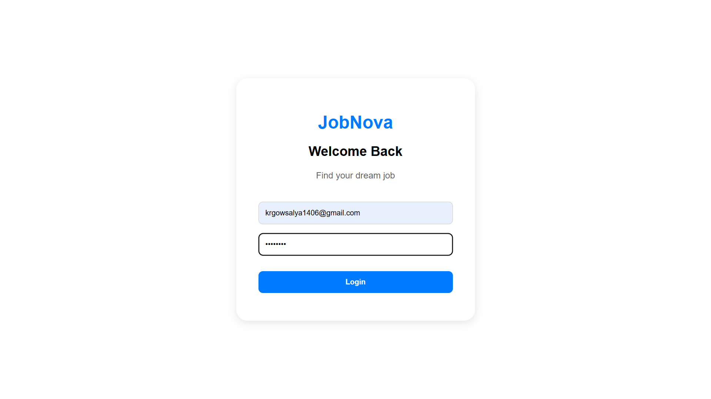
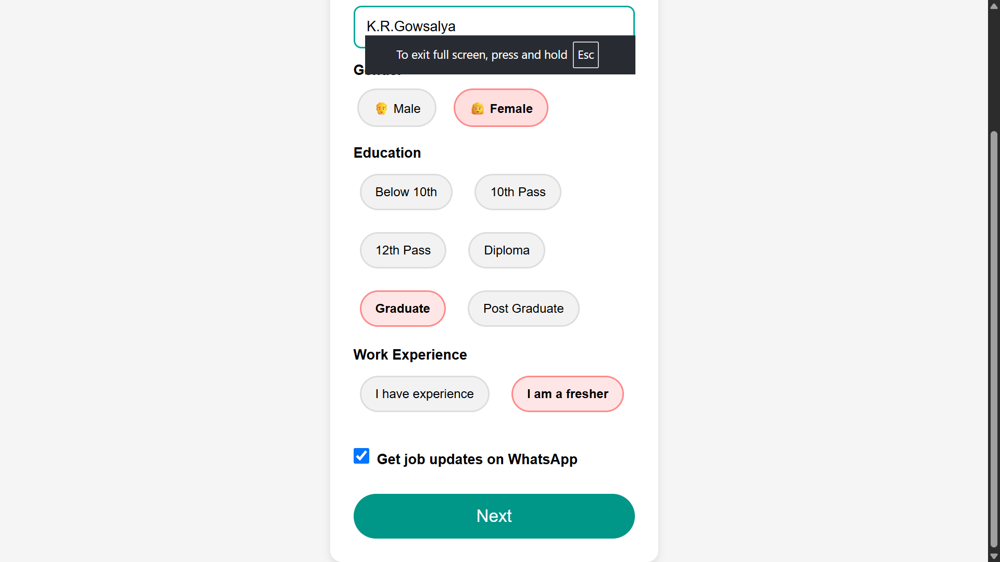
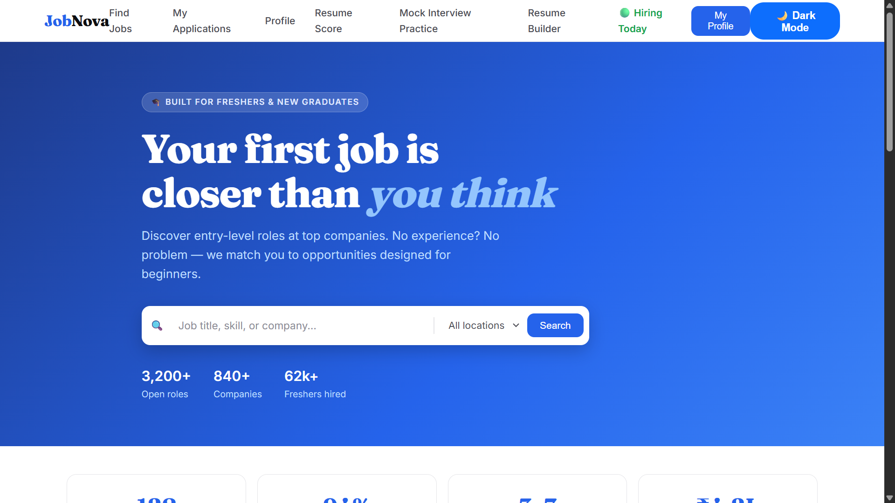
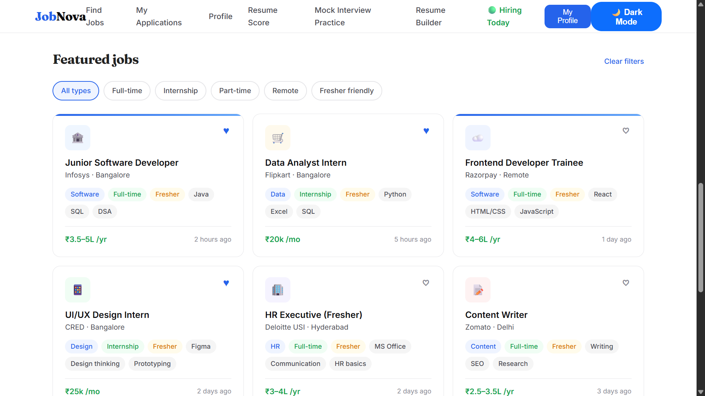
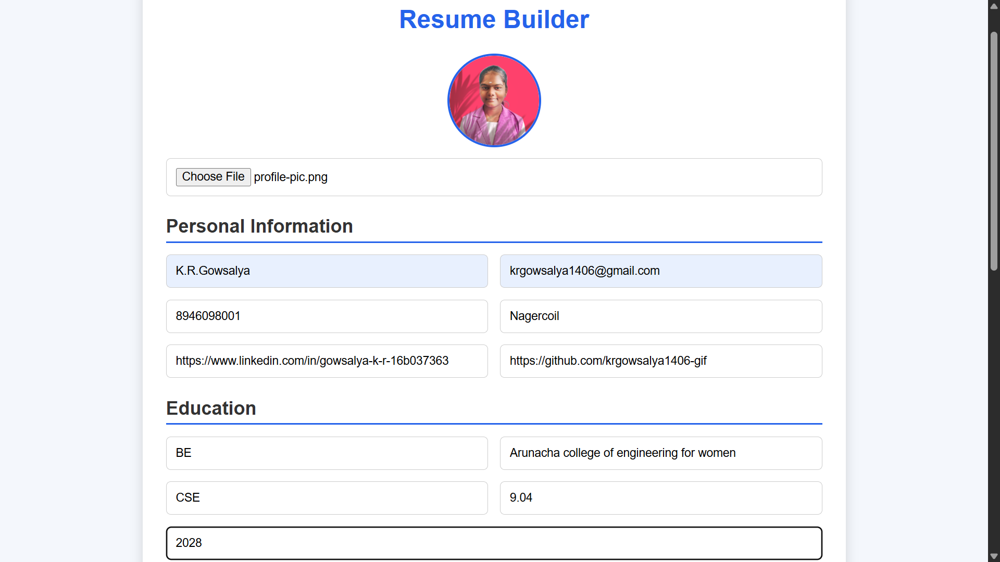
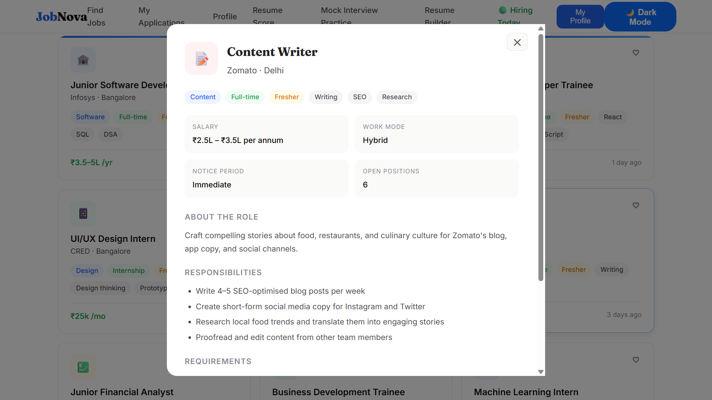
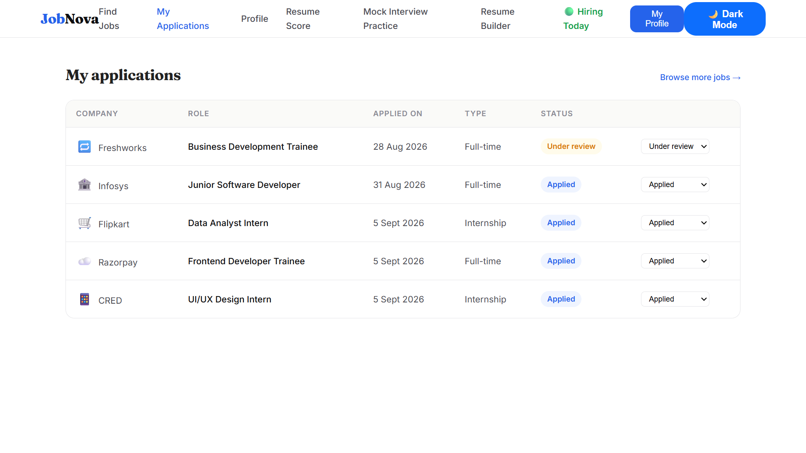
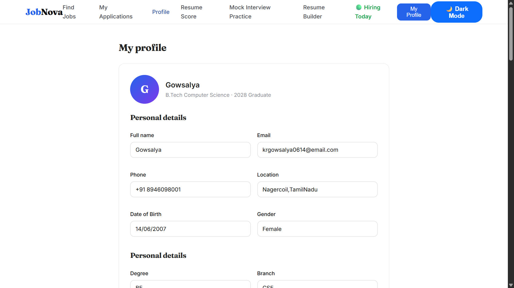
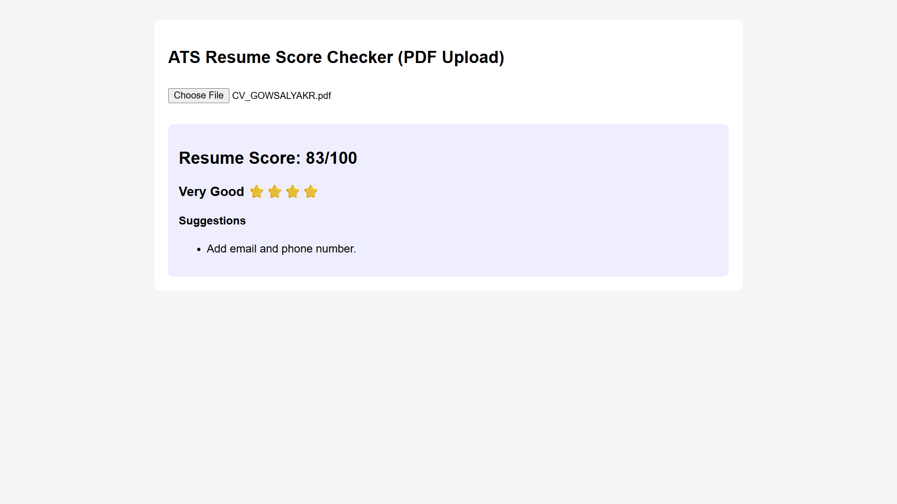
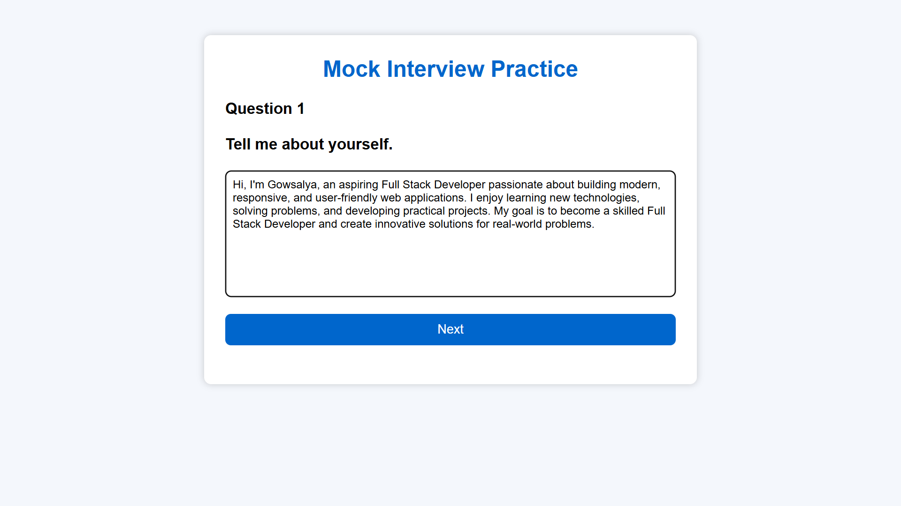

 
<div align="center">

# 💼 Online Job Portal


### 🚀 Discover Opportunities. Build Your Future.

A modern, responsive and interactive job portal designed to simplify the job-search journey for freshers and experienced professionals.

<br/>


<br/><br/>


</div>

---

## 🌟 About The Project

**Online Job Portal** is a user-friendly web application developed using HTML5, CSS3, and JavaScript.

The platform provides job seekers with a centralized space to discover suitable opportunities, create professional resumes, apply for jobs, track applications, and prepare for interviews.

It offers a complete career-support experience through an interactive dashboard, intelligent job search, resume tools, and interview preparation features.

### 🎯 Project Objective

The main objective is to develop a simple and efficient online platform that connects job seekers with suitable career opportunities while helping them manage their entire job-search process in one place.

---
---


## ✨ Features

<table>
<tr>
<td width="50%">

### 🔐 Account Management
- User Login & Registration
- Personalized User Profile
- Profile Management
- User Dashboard

### 🔍 Job Discovery
- Smart Job Search
- Advanced Job Filters
- Location-Based Search
- Featured Jobs
- Job Details
- Saved Jobs

</td>
<td width="50%">

### 📄 Career Tools
- Professional Resume Builder
- Resume Score Analyzer
- Resume Preview & Download
- Technical & HR Mock Interviews

### 📊 Application Management
- Apply for Jobs
- My Applications
- Application Status Tracking
- Interview Progress

### 🎨 User Experience
- Dark Mode
- Responsive Design
- Interactive Interface
- Easy Navigation

</td>
</tr>
</table>

---

## 📸 Screenshots

Explore the different modules of the Online Job Portal.

### 🔐 Login Page
A clean and responsive authentication interface that allows users to access their accounts using email and password.

<p align="center">

</p>

### 📝 Create Account
A simple registration interface to enter personal details, educational qualifications, gender, work experience, and job update preferences.

<p align="center">

</p>

### 🏠 Job Portal Dashboard
A personalized dashboard that provides quick access to job opportunities, applications, resume tools, profile management, and interview preparation.

<p align="center">

</p>

### ⭐ Featured Jobs
Discover popular and relevant job opportunities based on skills, interests, and qualifications.

<p align="center">

</p>

### 📄 Resume Builder
Create professional resumes by adding personal information, education, skills, certifications, projects, and experience.

<p align="center">

</p>

### 📝 Apply for Jobs
Explore job details and submit applications through a simple application interface.

<p align="center">

</p>

### 📋 My Applications
Track applied jobs, monitor application statuses, and manage interview progress.

<p align="center">

</p>

### 👤 My Profile
Manage personal information, education, skills, certifications, achievements, projects, and experience.

<p align="center">

</p>

### 📊 Resume Score Analyzer
Evaluate resume quality and receive suggestions to improve content, skills, formatting, and job relevance.

<p align="center">

</p>

### 🎤 Mock Interview
Practice common technical and HR interview questions to improve confidence, communication, and interview readiness.

<p align="center">

</p>

---

## 🛠 Tech Stack

<div align="center">

| Technology | Purpose |
|:---:|:---|
|  HTML5 | Web Structure |
|  CSS3 | Styling & Responsive Design |
|  JavaScript | Functionality & Interactivity |

<br/>


</div>

---

## 📁 Project Structure

```text
Online-Job-Portal/
│
├── index.html
├── builder.html
├── introduce.html
├── dashboard.html
├── jobs.html
├── resume.html
├── applications.html
├── profile.html
├── mock.html
├── web.html
│
├── style.css
├── introduce.css
├── location.css
│
├── script.js
├── introduce.js
├── location.js
│
└── image/
    ├── create.png
    ├── dashboard.png
    ├── featuredjob.png
    ├── interview.png
    ├── location.png
    ├── login.png
    ├── myapplication.png
    ├── profile.png
    ├── resumebuilder.png
    └── resumescore.png
```

---


---

## 🎥 Project Demo

Watch the project demonstration to explore the user interface and functionality.

<p align="center">

<a href="">

</a>

</p>

## 🚀 Live Demo

<p align="center">

<a href="prismatic-concha-c5fad9.netlify.app">

</a>

</p>

---

## 💡 Project Highlights

- **User-Friendly Interface:** Clean, responsive, and easy-to-navigate design.
- **Personalized Dashboard:** Centralized access to career-related activities.
- **Smart Job Search:** Find opportunities using search and filters.
- **Resume Builder:** Generate professional resumes.
- **Resume Score Analyzer:** Get feedback to improve resume quality.
- **Application Tracking:** Monitor job application progress.
- **Mock Interview:** Practice technical and HR questions.
- **Profile Management:** Maintain a professional career profile.
- **Dark Mode:** Enjoy a comfortable browsing experience.

---

## 🔮 Future Enhancements

The project can be enhanced with additional intelligent career-support features.

- 🤖 AI-Powered Job Recommendations
- 🔔 Automated Job Alerts
- 🧠 AI-Based Resume Analysis
- 🎤 AI Mock Interview with Personalized Feedback
- 📈 Skill Gap Analysis
- 📅 Online Interview Scheduling
- ⚡ Real-Time Application Updates
- 🏢 Recruiter Dashboard
- 📚 Online Course Integration
- 📱 Dedicated Mobile Application

---

## 🎓 Learning Outcomes

Through this project, I gained practical experience in:

- Building responsive web interfaces using HTML and CSS.
- Implementing interactive features using JavaScript.
- Developing multi-page web applications.
- Creating user-friendly forms and dashboards.
- Working with frontend navigation and application workflows.
- Understanding real-world career management requirements.

---

## 👩‍💻 Developer

<div align="center">


<div align="center">

### 💙 Built with Passion, Creativity & Code

**Every opportunity begins with a single step. Start your career journey today!**


</div>
